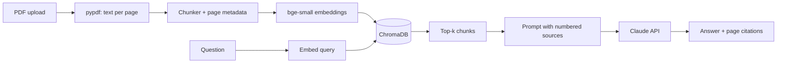

# 📄 Chat With Your Documents (RAG)

Upload PDFs and ask questions. Answers are grounded in your documents and cite the page each fact came from.

<!-- Add a demo GIF here -->

## How it works


## Stack
FastAPI · pypdf · sentence-transformers (`BAAI/bge-small-en-v1.5`) · ChromaDB · Claude API · Streamlit

## Setup
```bash
git clone https://github.com/YOUR_USERNAME/rag-chat-docs.git && cd rag-chat-docs
python -m venv .venv && source .venv/bin/activate
pip install -r requirements.txt
cp .env.example .env     # then add your ANTHROPIC_API_KEY
```

## Run
```bash
uvicorn app.main:app --reload      # terminal 1 (API docs at /docs)
streamlit run ui.py                # terminal 2
```

## Evaluation
Retrieval hit rate (correct page in top-k) on 10 hand-written questions:

| chunk_size | k=3 | k=5 | k=8 |
|---|---|---|---|
| 500 | | | |
| 800 | | | |
| 1200 | | | |

Run: `python eval/eval_retrieval.py your.pdf eval/questions.json`

## Limitations
- Scanned PDFs need OCR (not supported yet)
- Tables and multi-column layouts may extract poorly
- Fixed-size character chunking can split sentences

## What I'd improve next
- Cross-encoder reranking, hybrid BM25 + vector search
- Follow-up question rewriting, streaming answers
- Docker + hosted demo
